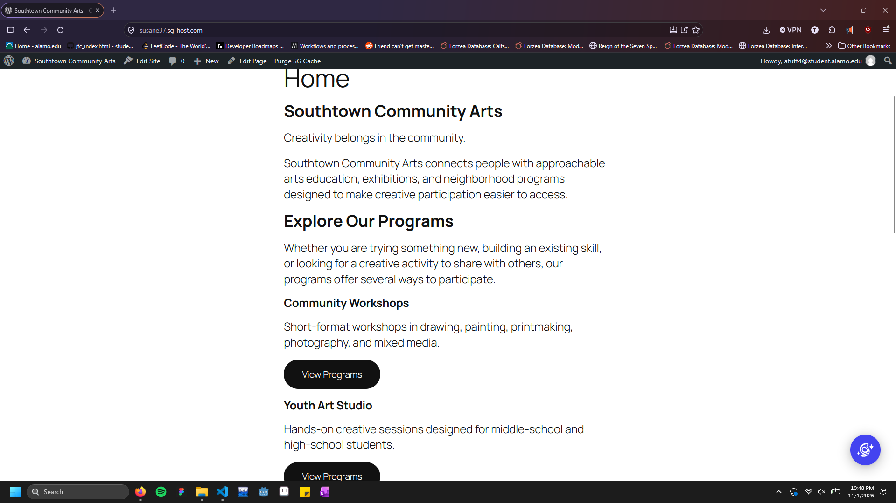
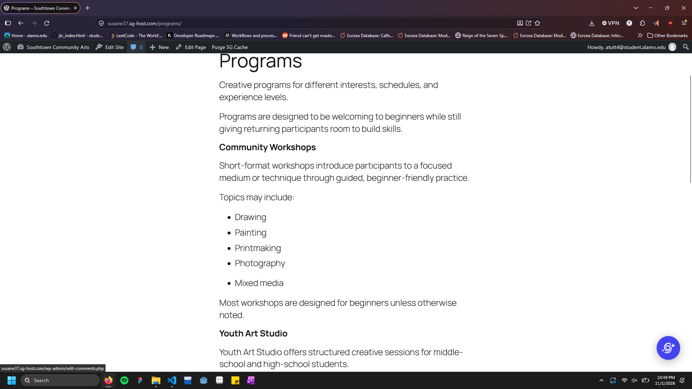
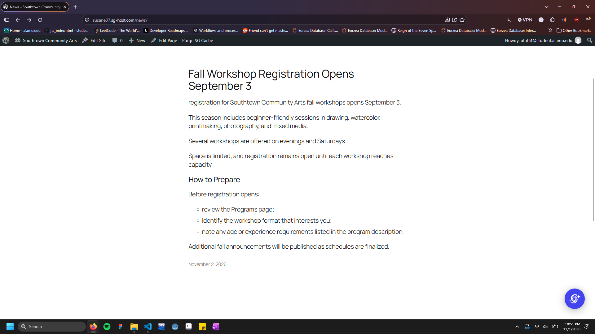
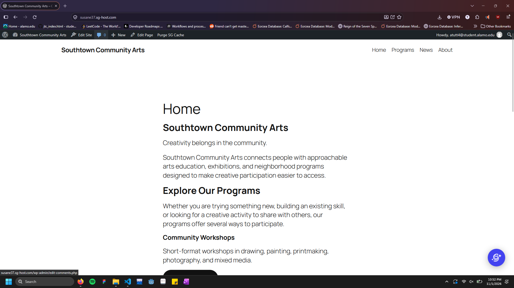
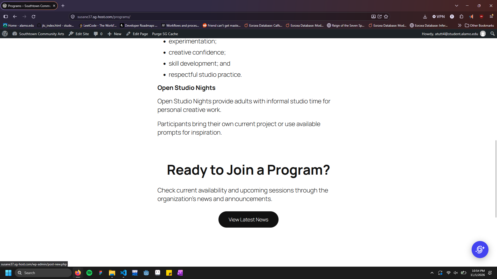
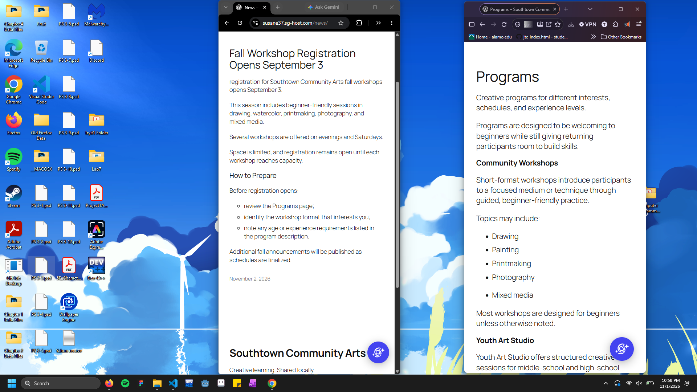

# Week 11: Build for Content — WordPress & CMS Fundamentals

## CMS Project Overview

**Client:** Southtown Community Arts  
**Role:** Junior Web / CMS Specialist  
**Week:** 11 — Build for Content: WordPress & CMS Fundamentals

Briefly summarize what you configured in WordPress.

I configured a community art center's webpage, allowing it to be easily editable to the center. Making it capable for them to change program and information depending on what is currently happening at the location and keeping users up-to-date.

---

## WordPress Site Access

**Site URL or instructor-access information:**  
[The current site](https://susane37.sg-host.com/southtown-community-arts/)

---

# Content Architecture

Explain how you organized the supplied client content.

## Pages

List the Pages you created and briefly explain why they belong as Pages.

- **Home:** The index page of the community website. It gives insight into the community art center, and allows you to get quick summary's of the provided programs.
- **Programs:** A page that goes more indepth in the available programs, pages allows you to quickly edit, incase a program is either temporarily or permanently no longer available.
- **About:** A page that tells about the community more, and tells more about their goals. This is a page incase the organization decides they wish to revamp it. this would allow them to do this with ease.

## Post

**News Post:** Fall Workshop Registration Opens September 3

Explain why this content belongs as a Post rather than a Page.

It's a time sensitive post directed at users, similar to that of an email or a social media post.

---

# Reusable Pattern

**Pattern Name:**  
Simple Call to action button

**Used For:**  
Used for the Visit current available programs section that can be found on the home and about pages.

**Why a Pattern Was Appropriate:**  
I believe a pattern was appropriate so that we could easily reuse this call to action button on multiple pages and having them match perfectly.

---

# Site-Wide Structure

Describe the required Site Editor change you completed.

**Change:**
Changes to the art's information found in the footer
**Where It Was Made:**  
Footer

**Why It Belongs at the Site Level:**  
This should affect all of the pages because the information is all around the same no matter which page you're looking at.

---

# Client Update Test

Complete `CLIENT-UPDATE.md` after the primary site build, then document the result here.

## Supplied Update

Briefly identify the client change you completed.

We completed a paragraph edit in the programs page.

## Where I Made the Update

What WordPress content-editing area did you use?

I made the edit in a paragraph block located near the top of the programs page.

## Structure Check

Did you need to modify the header, footer, navigation, template, template part, or reusable pattern? Explain.

no I didn't need to modify anything else, it was left the same as before.

## Maintainability Result

Explain how this update demonstrates that routine content can change without rebuilding the site's global structure.

It proves this sbecause I was able to quickly edit the text in less than a minute, and it saved and was viewable the next. This all occured without having to change anything else located on the page.

---

# Accessibility & Responsive Checks

Document the quality checks you completed.

## Headings

[Briefly explain how you verified logical heading structure.]

## Images

I wasn't able to find any images given to use in this assignment, but judging by how sophisticated the cms is, I'm sure it either offers alt text when adding an image, or you could use a pattern to achieve a similar affect.

## Links & Buttons

I linked the pages using the buttons and the chain link button at the top, afterwards I checked link/buttons in the published site to make sure they worked.

## Keyboard

I tested the keyboard controls, they seemed to work on buttons and links as intended.

## Responsive Layout

## I used my both firefox and google chrome, in different dimensions to confirm screen behaviour and responsiveness.

# Evidence

Replace the files in the `evidence/` folder with your own screenshots using the exact required filenames.

## Home Page

## Programs Page

## News Post

## Primary Navigation

## Reusable Pattern

## Narrow-Screen / Mobile View

---

# Developer Handoff

Keep each response concise and specific to this project.

## CMS Choice

Why is WordPress an appropriate solution for Southtown Community Arts?

It's easily accessable and editable for upcoming events, and post for the community. allows for ease of editing to match the arts theme, and since they're community ran, it helps to not need a tech professional for a long period of time.

## Editable Content

What information should Southtown Community Arts staff be able to update routinely?

With WordPress, staff should be able to regularly release post for the community. While also routinely be able to update available programs.

## Reusable Structure

What site element did you make reusable or site-wide, and why?

I made a call-to-action button reusable, since we were using it on pages to garner more attention to our programs, I also tried to make the footer site-wide, which I don't think I was able to achieve correctly, This is due to the information being helpful no matter which page it is located on.

## Client Protection

What design or architecture decision helps the site remain consistent when staff members make routine updates?

I created the the design of the page in the same manner, that we would in html, or how you would try to lay it out in an essay. I believe that this would allow staff to edit it with ease since they'd ideally know of the format as well.

## CMS Reflection

## I believe the type websites/clients are those that prefer a simpler website, probably with no mind to security. This is due to the fact that I believe that although easy to use and run, it might lack in the same security that a hand coded website could have. Although WordPress is extremely customizable, I feel as though it doesn't meet the same level as hand crafted websites that use languages like JavaScript.

# Final Handoff Check

- [x] Home, Programs, and About are published as Pages.
- [x] The supplied announcement is published as a Post.
- [x] Primary navigation works in the required order.
- [x] One meaningful reusable Pattern is present.
- [-] The required site-wide structure adjustment is complete.
- [x] I completed the supplied `CLIENT-UPDATE.md` request after the main build.
- [x] The client update did not require unnecessary global-structure changes.
- [x] Headings are logical.
- [-] Informative images have meaningful alternative text.
- [x] Link and button labels are understandable.
- [x] Keyboard focus is visible.
- [x] Narrow-screen behavior was checked.
- [x] All six evidence images display correctly in this README.
- [x] All four Developer Handoff responses are complete.
- [x] I committed and pushed this Week 11 handoff folder.
