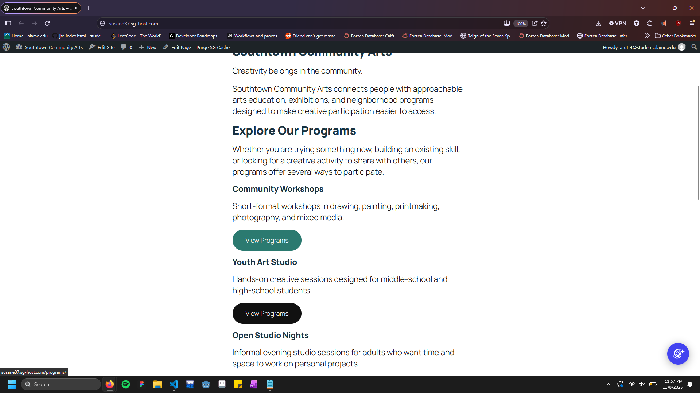
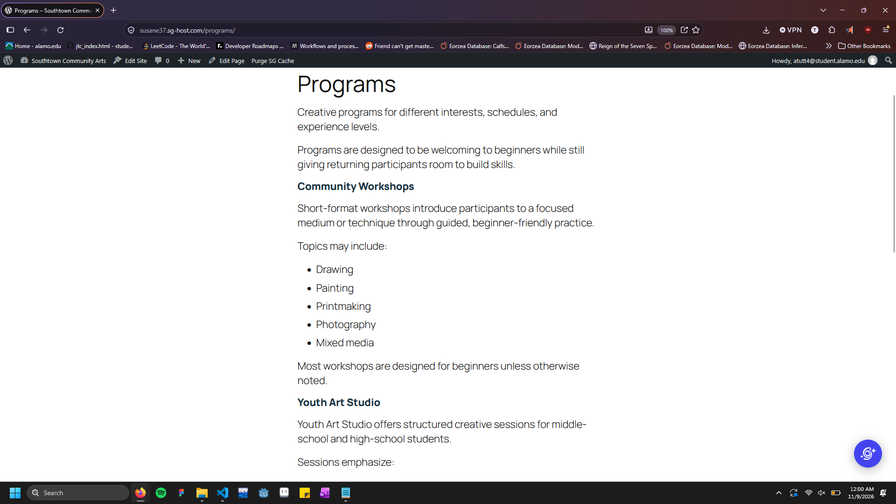
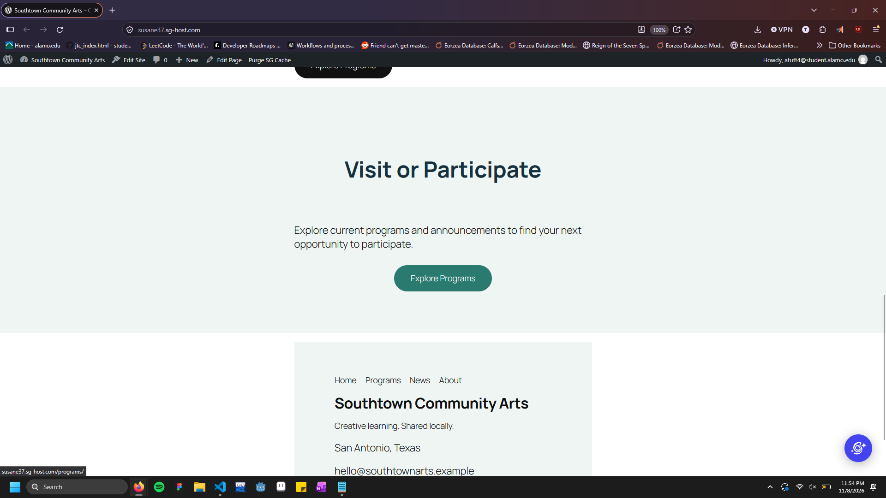
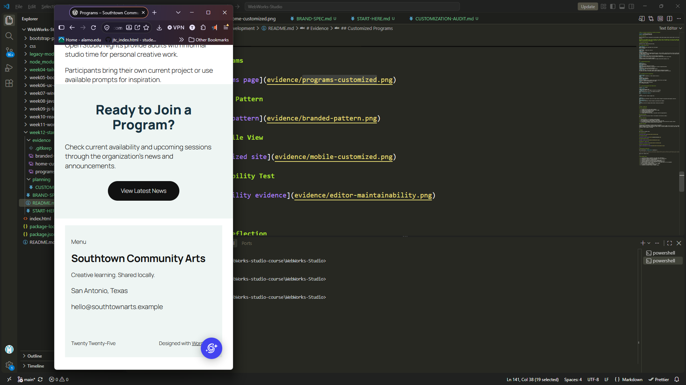

# Week 12: Customize the Experience — WordPress Development

**Client:** Southtown Community Arts  
**Role:** Junior WordPress Developer

## Project Overview

Briefly summarize how you customized the existing Week 11 CMS without making routine content harder for the client to maintain.

## Elements were changed to the client provided color scheme to edit the appearance of the word press page made in module 11. I was able to change pattern backgrounds, add hover affect to match scheme, and editing footer appearance without changing material of the page.

# Customization Decisions

Document the four required decisions below.

## 1. Global Design System

**Requirement:**  
[Which Southtown brand requirements were site-wide?]
Buttons, Headings

**Location:**  
[Global Styles / theme-level controls]
Global styles
**Change:**  
[What did you change?]
I changed headings to use the approved palette colors, and for buttons, the hover and focus colors so that users can tell where they're hovering, with a mouse or keyboard. I tried to do something similar to my custom made patterns, but my artistic ability is weak.
**Why this level:**  
[Why was a global solution better than editing pages individually?]
So that all buttons would be able to have this affect without having to go to each button.
**QA:**  
[What did you test after the global change?]
I tested to make sure the affects working in the page preview before pushing it out.

---

## 2. Branded Reusable Pattern

**Pattern:**  
[Name the pattern.]
Visit Program Pattern
**Change:**  
[What visual/system changes did you make?]
Changed backgrounds and buttons on the patterns to match the approved palette.
**Reuse:**  
[Where did you reuse or verify the pattern?]
I reused this in the home section and about section.
**Editor value:**  
[How does this help a future editor update content without rebuilding the design?]
It allows you to edit a cta button easily without changing the website content/structure.

---

## 3. Site-Wide Structure Customization

**Shared area:**  
[Header, footer, navigation, or other shared structure.]
Footer
**Change:**  
[What did you customize?]
Centered, added background.
**Why this level:**  
[Why did the change belong in shared site structure rather than on one Page?]
so that it's shares this appearance across pages.
**QA:**  
[Which pages did you check afterward?]
All of the page afterwards.

---

## 4. Controlled Development-Level Modification

Complete **one** option.

**Option used:**  
[theme.json OR targeted CSS]
I couldn't find where I was suppose to input this, apologies.
**Location:**  
[Where the modification lives in the supplied environment.]
n/a
**Code / configuration snippet:**
n/a

```text
Paste only the small relevant snippet here.
```

**Reason:**  
[What legitimate requirement could not be solved cleanly through the available editor/global controls?]
n/a
**Documentation:**  
[Which official WordPress reference helped you understand the change?]
n/a
**QA:**  
[How did you verify the change worked without creating new problems?]
n/a

---

# Visitor + Editor QA

## Visitor Experience

- [ ] I tested narrow and wide viewport behavior.
- [ ] I checked visual consistency on more than one page.
- [ ] I checked text/link/button contrast.
- [ ] I verified visible keyboard focus.
- [ ] I tested navigation and links.
- [ ] I checked that the brand system is consistent rather than page-specific.

### Visitor QA Notes

[Briefly describe one issue you found or one important verification you made.]
n/a

## Editor Experience

- [ ] Routine content is still editable through WordPress.
- [ ] The branded pattern is understandable to reuse/edit.
- [ ] My customization did not move ordinary client content into code.
- [ ] I performed one temporary routine content edit, previewed it, and restored the original content.
- [ ] The site remained visually coherent after the editor test.

### Editor QA Notes

[Briefly describe the update you tested and what you verified.]
I tested these in both preview, and the full page. Although it initially lagged, after some time it fully loaded and worked as intended. As for the code editing, I wasn't able to find the location for the json/css code input. hence why nothing has really changed in the page.

---

# Evidence

Use the exact filenames below.

## Customized Home



## Customized Programs



## Branded Reusable Pattern



## Responsive / Mobile View



## Editor Maintainability Test


---

# Maintainability Reflection

Write approximately **75–100 words** responding to:

> Give one example of a change you intentionally handled globally and one change you intentionally left as editable content. How does that separation help Southtown Community Arts maintain the site without losing design consistency?

[Write your response here.]
I was able to complete about half this assignment this time. I'm not sure I completed this correctly. I found ways of creating and editing, patterns through this assignment, but it felt difficult as nothing seemed to suit the idea I had for this sight in mind. I also couldn't find the json/css editor. I searched through the wordpress and the documents provided trying to search for it, but I couldn't find it for some reason.

---

# Final Handoff Check

- [ ] I continued the Week 11 Southtown site rather than rebuilding it.
- [ ] I applied the approved palette and typography direction systematically.
- [ ] I used global controls for global decisions.
- [ ] I created or significantly customized one branded reusable pattern.
- [ ] I made one appropriate site-wide structure customization.
- [ ] I completed exactly one controlled development-level modification.
- [ ] I did not add PHP, plugins, custom blocks, or a child-theme build for this assignment.
- [ ] Visitor and editor QA are complete.
- [ ] All five evidence screenshots display in this README.
- [ ] I completed the maintainability reflection.
- [ ] I committed and pushed the Week 12 handoff folder.
